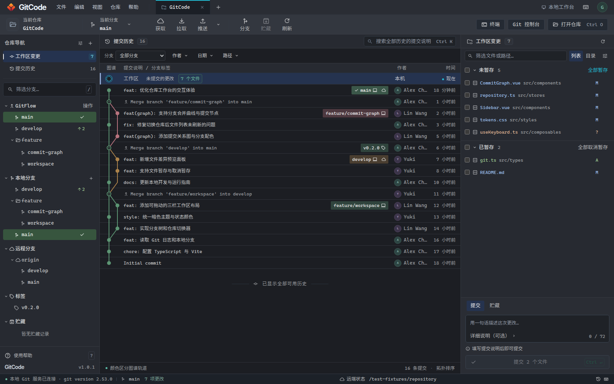
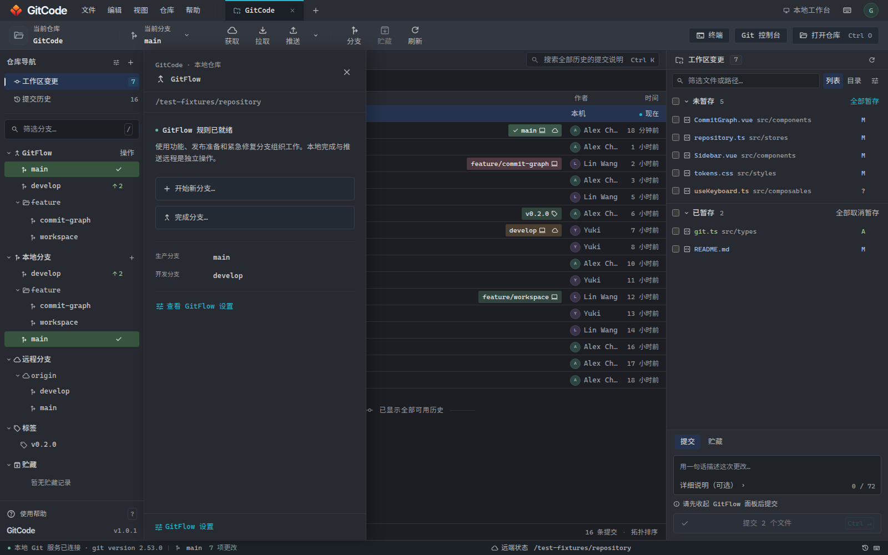

<p align="center">
  <picture>
    <source media="(prefers-color-scheme: dark)" srcset="packages/brand/assets/logo-glyph-transparent-256.png" />
    
  </picture>
</p>

<h1 align="center">GitCode</h1>

<p align="center"><strong>看清每次变更，掌控每条分支。</strong></p>
<p align="center">提交关系、工作区变更与 GitFlow，连接在同一个本地工作台。</p>

<p align="center">
  
  
  
  
  <a href="LICENSE"></a>
</p>

<p align="center">
  <a href="http://8.138.163.129/">在线预览</a> ·
  <a href="#快速开始">快速开始</a> ·
  <a href="apps/desktop/README.md">桌面文档</a> ·
  <a href="https://github.com/dzxing/gitcode/issues">问题反馈</a>
</p>

> [!IMPORTANT]
> 本项目采用自定义的**非商业、禁止修改与衍生作品许可**，属于源码可见项目，并非 OSI 定义的开源软件。允许个人非商业学习、研究、测试和原样使用；未经著作权人另行书面授权，禁止商业使用及二次改造。完整条款见 [LICENSE](LICENSE)，第三方材料遵循其各自许可。

## 本地 Git 工作台

GitCode 使用 **Electron + Vue 3 + TypeScript** 构建，直接调用本机 Git，无需运行远程业务服务器。桌面应用面向 Windows、macOS 和 Linux；仓库同时包含独立的 Nuxt 产品网站。

<p align="center">
  
</p>

<p align="center"><sub>实际产品界面，使用测试用示例仓库。</sub></p>

| 功能                  | 在工作台中完成                                           |
| --------------------- | -------------------------------------------------------- |
| **提交关系图**        | 查看分支与合并关系、提交详情，搜索和定位历史提交         |
| **仓库与分支**        | 打开、创建与克隆仓库，管理本地分支、远程分支、标签和收藏 |
| **工作区变更**        | 查看文件差异、暂存、提交，以及贮藏和恢复未提交的更改     |
| **GitFlow**           | 初始化基础分支，管理 Feature、Release 与 Hotfix 流程     |
| **同步与冲突**        | 获取、拉取和推送，查看冲突文件并使用冲突编辑器处理       |
| **历史与比较**        | 查看文件历史、比较文件版本及 HEAD／暂存区／工作区        |
| **终端与 Git 控制台** | 使用终端会话，在 Git 控制台查看应用执行的命令与结果      |
| **主题与字体**        | 切换主题，分别调整界面和编辑器字体，保存工作区布局       |

<details>
  <summary><strong>查看 GitFlow 界面</strong></summary>

  <p></p>
</details>

## 快速开始

需要 **Node.js 22.22.3、Bun 1.3.14 和 Git 2.30+**。也支持 Node.js 24.15+ 的 24.x 版本；其他受支持版本见根目录 `package.json`。应用使用系统安装的 Git，不自带 Git。

```bash
git clone https://github.com/dzxing/gitcode.git
cd gitcode
bun install --frozen-lockfile
bun run desktop
```

仅在浏览器中体验开发界面：

```bash
bun run dev
```

打开 <http://localhost:43187>。浏览器模式会连接本机 Git 核心，操作的是真实仓库；初次体验建议使用测试仓库。

| 场景                     | 命令                        |
| ------------------------ | --------------------------- |
| 启动桌面应用             | `bun run desktop`           |
| WSL 桌面开发             | `bun run desktop:wsl`       |
| 启动产品网站             | `bun run dev:website`       |
| 检查整个工作区           | `bun run check`             |
| 构建当前系统的桌面安装包 | `bun run desktop:build`     |
| 在 Windows 构建安装包    | `bun run desktop:build:win` |
| 构建静态网站             | `bun run build:website`     |

Windows、WSL 和 macOS 应分别安装依赖，不共用 `node_modules`。macOS 打包需要 macOS 构建环境，签名与公证需另行配置。详细平台说明见[桌面文档](apps/desktop/README.md)。

安装包将在 [GitHub Releases](https://github.com/dzxing/gitcode/releases) 提供；当前 README 不代表已有公开安装包或已完成平台签名。

## 项目结构

```text
apps/
  desktop/       Electron + Vue 桌面应用与本机 Git 核心
  website/       Nuxt + Nuxt UI 静态产品网站
packages/
  brand/         共享品牌资源
scripts/         工作区公共检查
docs/            开发与工作区说明
legacy/          历史原型，不参与运行和打包
```

开发环境、完整命令和模块边界见[开发与工作区](docs/DEVELOPMENT.md)；网站维护见[门户文档](apps/website/README.md)。

## 反馈与许可

欢迎通过 [Issues](https://github.com/dzxing/gitcode/issues) 提交问题、复现步骤与功能建议。修改或衍生版本需先获得书面授权；开放 Issues 不代表授予二次开发许可。

| 行为                                           | 本项目原创部分的许可范围       |
| ---------------------------------------------- | ------------------------------ |
| 个人非商业学习、研究、测试及原样使用           | 允许                           |
| 克隆、备份与按文档原样编译                     | 允许，需保留许可和声明         |
| 免费、完整地分享未修改的源码或原样构建产物     | 允许，需附完整许可和第三方声明 |
| 商业使用，包括企业内部业务、收费分发与付费服务 | 未经另行书面授权，禁止         |
| 修改源码、二次开发、换皮及发布衍生版本         | 未经另行书面授权，禁止         |
| 独立使用第三方组件                             | 以该组件自身许可为准           |

完整条款：[GitCode Source-Available Non-Commercial No-Derivatives License 1.0](LICENSE)。本许可不限制 GitHub 平台条款所允许的浏览和 Fork，也不限制第三方材料原有许可授予的权利。

Copyright © 2026 dzxing. 第三方著作权与许可见[第三方声明](THIRD_PARTY_NOTICES.md)。
