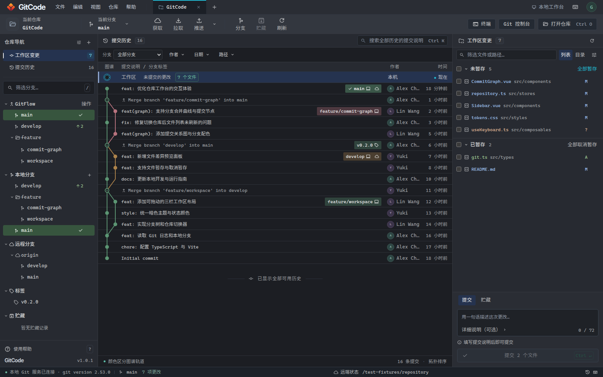
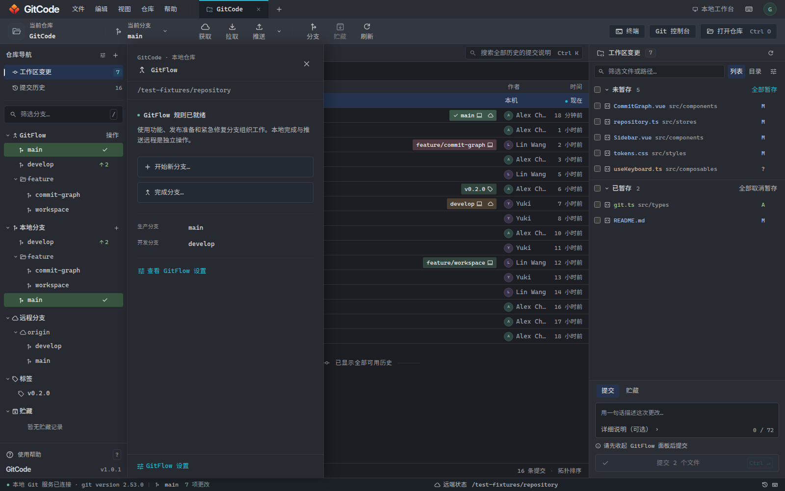

<p align="center">
  <picture>
    <source media="(prefers-color-scheme: dark)" srcset="packages/brand/assets/logo-glyph-transparent-256.png" />
    
  </picture>
</p>

<h1 align="center">GitCode</h1>

<p align="center"><a href="README.md">English</a> · <strong>简体中文</strong></p>

<p align="center"><strong>看清每次变更，掌控每条分支。</strong></p>
<p align="center">提交关系、工作区变更与 GitFlow，连接在同一个本地工作台。</p>

<p align="center">
  
  
  
  
  <a href="LICENSE"></a>
</p>

<p align="center">
  <a href="http://8.138.163.129/">产品网站</a> ·
  <a href="#快速开始">快速开始</a> ·
  <a href="apps/desktop/README.md">桌面文档</a> ·
  <a href="https://github.com/dzxing/gitcode/issues">问题反馈</a>
</p>

<p align="center">
  
</p>

## 快速开始

安装 **Git 2.30+、Node.js 22.22.3 和 Bun 1.3.14**，然后运行：

```bash
git clone https://github.com/dzxing/gitcode.git
cd gitcode
bun install --frozen-lockfile
bun run desktop
```

WSL 下使用 `bun run desktop:wsl` 启动。其他环境和打包命令见[开发文档](docs/DEVELOPMENT.md)。

## 使用

### 打开仓库

在首页选择 **打开仓库**，选中已有 Git 仓库目录；也可以选择 **克隆仓库** 或 **创建仓库**。
如果提示找不到 Git，在「设置 → Git → Git 运行环境」中选择本机 Git 可执行文件。

### 提交更改

1. 在 **工作区变更** 中选择文件，查看差异。
2. 将需要提交的文件加入暂存区。
3. 输入提交说明，点击 **提交**。

### 同步远程

- **获取**：更新远程分支信息。
- **拉取**：将远程更新合并到当前分支。
- **推送**：发布本地提交，首次推送时确认远程和目标分支。

遇到冲突时，打开冲突文件处理，标记解决后继续操作。

### 使用 GitFlow

1. 打开仓库导航中的 **GitFlow 操作面板**，配置生产分支、开发分支和分支前缀。
2. 选择 **Feature**，输入名称并确认起点，创建并切换到功能分支。
3. 开发后提交更改，按需推送功能分支。
4. 完成功能时核对合并目标，处理可能出现的冲突，再按需推送合并结果。

<details>
  <summary>查看 GitFlow 界面</summary>
  <p></p>
</details>

## 文档与反馈

[桌面使用说明](apps/desktop/README.md) · [开发与打包](docs/DEVELOPMENT.md) · [网站维护](apps/website/README.md) · [问题反馈](https://github.com/dzxing/gitcode/issues)

## 许可

仅限非商业用途，禁止修改和二次开发，另有书面授权除外。完整条款见 [LICENSE](LICENSE)；第三方组件遵循各自许可，见[第三方声明](THIRD_PARTY_NOTICES.md)。
